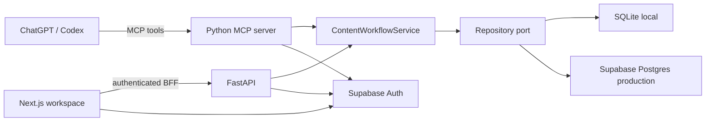

# ContentOps

**Magyar útmutatók:** [Használat](docs/HASZNALATI_UTMUTATO.md) · [Telepítés és ChatGPT-bekötés](docs/DEPLOYMENT_HU.md) · [Kitölthető telepítési csomag](deploy/README.md) · [Első próba](docs/FIRST_TRIAL_HU.md).

ContentOps is a private editorial workspace for turning raw ideas and sourced research into reviewed, versioned LinkedIn drafts. It is both a useful single-owner application and a portfolio project built around production Python, MCP, TypeScript, Supabase, and Vercel.

The application deliberately does **not** contain an LLM provider. ChatGPT or Codex performs research and writing; ContentOps owns durable workflow state, exact-version approval, audit history, and a human-controlled LinkedIn handoff.

## Product flow

For a walking note, choose **Mentés későbbre** to keep only the idea, or **Mentés és draftkérés** to save it and copy a prepared request into your connected ChatGPT conversation. Send that request there: the host reads the saved idea and writing context through MCP, writes the full draft, and saves a new version. The workspace refreshes on focus and every 15 seconds while visible. Review and approval remain explicit user actions.

The web button prepares a handoff; it does not start a background ChatGPT job. No model API key or separate model-provider billing is used by this application. A working host MCP connection is required and must be tested in the target account. See [the workflow guide](docs/MCP_IDEA_WORKFLOW.md).

```text
idea or sourced research
  -> immutable draft versions
  -> feedback or exact-version approval
  -> internal publication plan
  -> user schedules in LinkedIn
  -> manual confirmation and performance snapshot
```

Approval never publishes a post. ContentOps does not scrape LinkedIn, automate its website, or automate engagement.

## Architecture



The Python application service is the use-case boundary. FastAPI and MCP are adapters over the same service and repository protocol. The Next.js app uses one typed client through a same-origin BFF; it does not duplicate workflow rules.

## Implemented

- idea and sourced-research capture;
- immutable draft versions with SHA-256 hashes;
- revision feedback and exact-current-version approval;
- approval revocation and archive state;
- durable voice, audience, and language profile;
- internal planning, native-scheduler confirmation, publication confirmation, and manual metrics;
- audit events, idempotent writes, JSON workspace export;
- 18 MCP tools and a reusable workflow skill;
- durable professional background and a curated library of up to 50 authentic past posts, with per-post example selection;
- SQLite development and Postgres production adapters;
- local auth mode and Supabase JWT owner verification;
- responsive editorial workspace, Supabase login, and installable PWA shell.

## Local development

Requirements: Python 3.12+, [uv](https://docs.astral.sh/uv/), Node.js 22+, npm.

```powershell
cd backend
uv sync
uv run uvicorn app.main:app --reload --port 8000
```

In a second terminal:

```powershell
npm install
npm run dev
```

Open `http://localhost:3000`. Local mode uses `backend/.data/contentops.db` and requires no cloud credentials.

Run the local MCP server over stdio:

```powershell
cd backend
uv run python -m app.mcp_server --transport stdio
```

Or expose its HTTP transport locally:

```powershell
uv run python -m app.mcp_server --transport streamable-http
```

## Configuration

Copy the example values into untracked `.env.local` and `backend/.env` files as needed.

Frontend:

```dotenv
PYTHON_BACKEND_URL=http://localhost:8000
NEXT_PUBLIC_SUPABASE_URL=
NEXT_PUBLIC_SUPABASE_PUBLISHABLE_KEY=
```

Python production mode:

```dotenv
CONTENTOPS_DATABASE_URL=postgresql://...
AUTH_MODE=supabase
SUPABASE_URL=https://PROJECT.supabase.co
SUPABASE_JWT_AUDIENCE=authenticated
CONTENTOPS_OWNER_USER_ID=SUPABASE_USER_UUID
MCP_PUBLIC_URL=https://api.example.com/mcp
FRONTEND_ORIGIN=https://app.example.com
```

`CONTENTOPS_OWNER_USER_ID` intentionally enforces a single-owner MVP. Multi-tenancy is not simulated with incomplete row filtering.

## Verification

```powershell
npm run check
cd backend
uv run ruff check app tests
uv run pytest
```

Current automated coverage includes API lifecycle, retry idempotency, concurrent writes, stale-version rejection, editor recovery, asynchronous workspace refresh, exact-version approval, MCP contracts, and cross-surface persistence. CI also runs the repository lifecycle against PostgreSQL 17. Locally, that test skips unless a dedicated `CONTENTOPS_TEST_DATABASE_URL` is supplied; it creates and drops only its own random test schema.

## Deployment boundary

Follow [the deployment and ChatGPT setup guide (Hungarian)](docs/DEPLOYMENT_HU.md). It includes the Docker entrypoint, private storage schema, OAuth consent UI, dedicated client registration and resource-bound token hook.

The repository is deployment-ready, but account-owned setup remains external:

1. Create Supabase Postgres and Auth resources; create the owner account and record its user UUID.
2. Deploy the combined Python ASGI application using `backend/Dockerfile`: API at `/api`, MCP at `/mcp`, readiness at `/api/ready`.
3. Deploy Next.js to Vercel with Supabase variables, server-only owner/client IDs, and the Python backend URL ending in `/api`.
4. Change `plugins/contentops-mcp/.mcp.json` to the HTTPS MCP endpoint for remote installation.
5. Run the cases in `docs/MCP_EVALUATION.md` in the target ChatGPT/Codex account.

## Project map

- `backend/app/content/`: domain models, repository port/adapters, application service, API models and routes
- `backend/app/mcp_server.py`: MCP adapter and tool contracts
- `backend/app/auth.py`: local and Supabase JWT authentication
- `app/`: Next.js workspace, auth callback, BFF, PWA metadata
- `plugins/contentops-mcp/`: installable plugin manifest and workflow skill
- `docs/LINKEDIN_COMPLIANCE.md`: active LinkedIn safety boundary
- `documentations/ADR.md`: current architecture decisions
